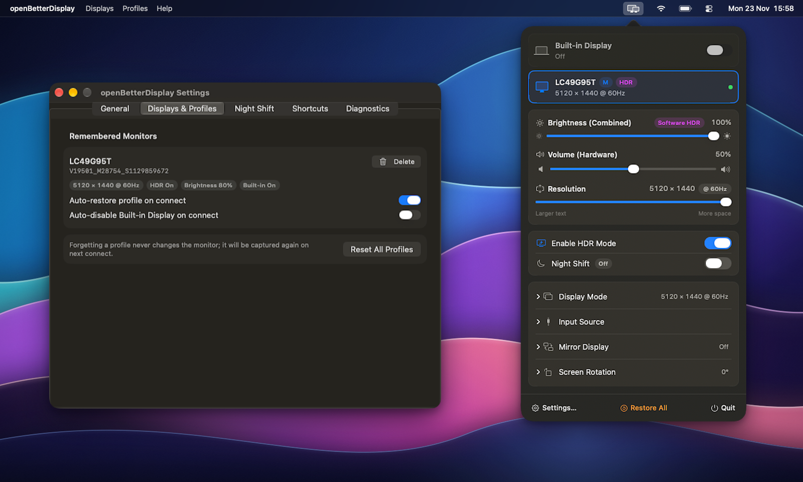
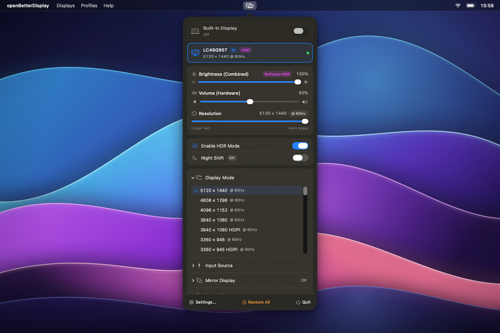
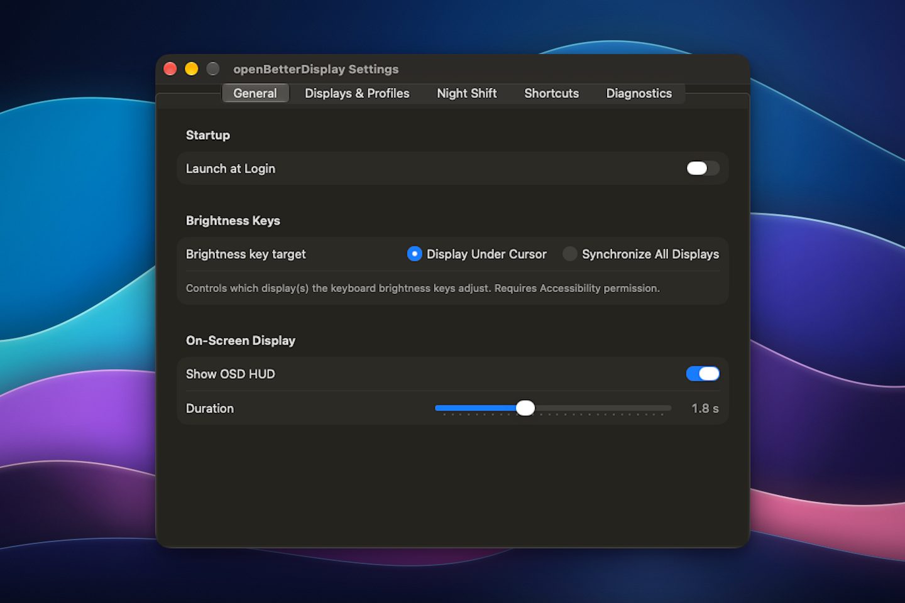
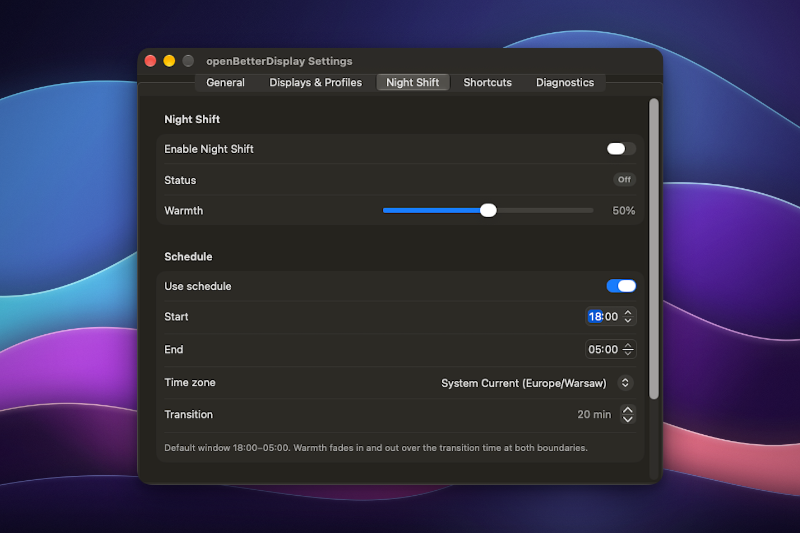
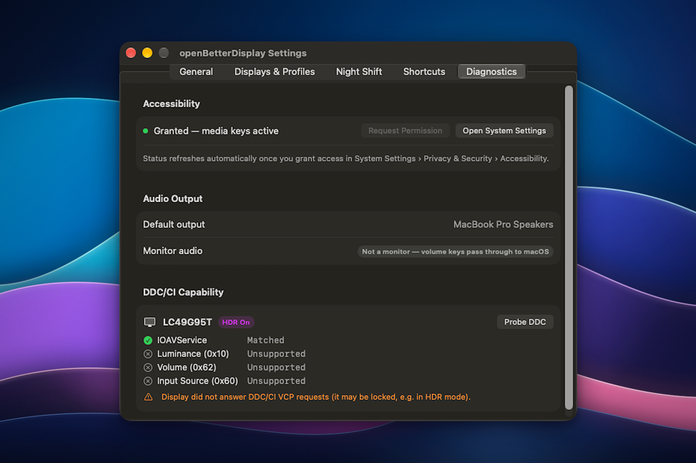

<div align="center">

# openBetterDisplay

Lightweight, native macOS menu bar utility for MacBook + external monitors — zero virtual-display bloat, built for super-ultrawide & HDR panels.

`macOS 14+` · `Apple Silicon` · `SwiftUI` · `MIT`



</div>

<table>
  <tr>
    <td width="50%" align="center">
      <br />
      <b>Display Modes &amp; Resolutions</b>
    </td>
    <td width="50%" align="center">
      <br />
      <b>General &amp; Media Keys</b>
    </td>
  </tr>
  <tr>
    <td width="50%" align="center">
      <br />
      <b>Hybrid Night Shift (18:00–05:00)</b>
    </td>
    <td width="50%" align="center">
      <br />
      <b>Live DDC/CI Diagnostics</b>
    </td>
  </tr>
</table>

## Highlights

- **Lid-Open Built-in Display Off** — Soft-disconnect the MacBook panel while keeping keyboard, trackpad & Touch ID active, protected by hotplug/wake/quit watchdogs and emergency **`⌃⌥⌘R`** restore.
- **Per-Monitor Hotplug Profiles** — Remembers resolution, refresh rate, HDR, brightness, volume, Main Display, and built-in state per monitor (`Vendor / Model / Serial`) and auto-restores on reconnect.
- **Combined DDC + `Software HDR` Dimming** — Hardware DDC/CI luminance in SDR transitioning smoothly to a private software dimming overlay (`sharingType = .none`) below 20% or when HDR locks DDC — never leaking into captures or screen shares.
- **Hybrid Night Shift (`18:00–05:00`)** — Native `CoreBrightness` plus calibrated warm overlay fallback for external and HDR displays with configurable fade transitions.
- **Native Modes, HiDPI, HDR, Input Source & Rotation** — Fast switching for native/HiDPI resolutions, refresh rates, HDR, DDC inputs (`VCP 0x60`), mirroring, and 0°–270° rotation.
- **Conditional DDC Volume** — Intercepts media volume keys (`F10`–`F12`) only when the external monitor is macOS's active CoreAudio output; built-in speakers, headphones, and Bluetooth pass through untouched.

## Quick Start

```bash
xcodegen generate && ./scripts/install.sh
xcodebuild -project openBetterDisplay.xcodeproj -scheme openBetterDisplay -destination 'platform=macOS,arch=arm64' test
./scripts/release.sh 1.0.0   # Notarized Developer ID DMG
```

> **Permissions & Distribution:** Grant **Accessibility** for keyboard media keys and global shortcuts (Screen Recording is never required). Distributed directly via notarized Developer ID builds rather than the sandboxed Mac App Store to allow direct `SkyLight` / `IOAVService` hardware control.

[Full Specification (`docs/SPEC.md`)](docs/SPEC.md) · [MIT License](LICENSE)
